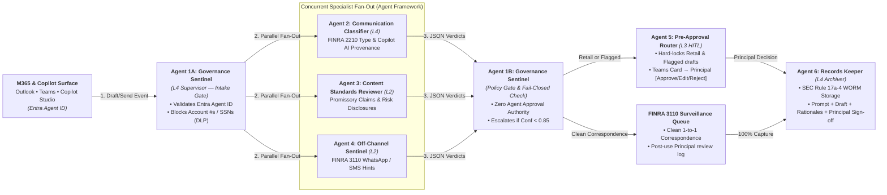

# Zero-Trust Agentic Supervision for Wealth Management Communications
**Microsoft Foundry • .NET Agent Framework • Blazor Server Command Center**

> **Core Compliance Invariant:** **Zero Agent Approval Authority** — AI agents classify, score regulatory risk, enforce Data Loss Prevention (DLP), route drafts, and compile immutable records, while **Registered Principals retain 100% of approval authority** in accordance with FINRA Rules 2210 and 3110, FINRA Regulatory Notice 24-09, and SEC Rule 17a-4.

---

## Table of Contents
1. [Executive Overview & Regulatory Anchors](#1-executive-overview--regulatory-anchors)
2. [End-to-End Solution Architecture](#2-end-to-end-solution-architecture)
3. [Multi-Agent Roster & Orchestration Pattern](#3-multi-agent-roster--orchestration-pattern)
4. [Prerequisites & Local Environment Setup](#4-prerequisites--local-environment-setup)
5. [Step-by-Step Blazor Application Setup](#5-step-by-step-blazor-application-setup)
6. [Configuring Live Microsoft Foundry vs. Offline Demo Mode](#6-configuring-live-microsoft-foundry-vs-offline-demo-mode)
7. [Panel Presentation Demo Walkthrough (Under 2 Minutes)](#7-panel-presentation-demo-walkthrough-under-2-minutes)
8. [Code-to-Architecture Traceability Matrix](#8-code-to-architecture-traceability-matrix)

---

## 1. Executive Overview & Regulatory Anchors

Financial advisors across wealth management firms increasingly draft client emails, meeting recaps, and market commentary using **Microsoft 365 Copilot** and **Copilot Studio** agents. Legacy compliance engines rely on blunt lexicon-based keyword sampling of ~3% of communications—creating a **97% blind spot**, drowning supervisory principals in false positives, and leaving firms exposed to nine-figure regulatory penalties.

This reference implementation replaces 3% keyword sampling with **100% event-driven multi-agent supervision** anchored to four core regulations:

| Regulatory Standard | Scope & Requirement | Architectural Enforcement in This Solution |
| :--- | :--- | :--- |
| **FINRA Rule 2210** | Communications with the Public (*Correspondence* $\le 25$ retail vs. *Retail* $> 25$ retail vs. *Institutional*). Requires fair, balanced content and pre-use Principal approval for retail outreach. | **Agent 2** classifies rule category; **Agent 3** checks promissory language and risk disclosures; **Agent 5** hard-locks Retail drafts until a Registered Principal approves in Teams. |
| **FINRA Rule 3110** | Internal Supervision & Written Supervisory Procedures (WSPs). Requires active surveillance of correspondence and detection of unapproved off-channel messaging. | **Agent 4** detects WhatsApp/SMS/personal email migration hints; clean 1-to-1 correspondence routes to a **Post-Use Principal Surveillance Log** (never agent-approved). |
| **FINRA Regulatory Notice 24-09** | Generative AI & Large Language Models. Confirms securities rules are technology-neutral and require governance, provenance tracking, and explainability for AI-generated content. | **Agent 2** flags M365 Copilot / Copilot Studio AI provenance; **Agent 1** enforces a `< 85%` confidence Fail-Closed gate and logs full model rationales. |
| **SEC Rule 17a-4** | Books & Records Preservation. Requires 3-to-6+ year retention in non-rewriteable, non-erasable (WORM) or audit-trailed storage including prompts and responses. | **Agent 6** captures the original user prompt, AI draft, 6-agent reasoning chain, and Principal sign-off into a WORM vault with Purview eDiscovery holds on **100% of paths**. |

---

## 2. End-to-End Solution Architecture

Every visual box in the solution architecture maps directly to a concrete C# class, agent instance, or deterministic gate inside `SupervisionOrchestratorService.cs`.



---

## 3. Multi-Agent Roster & Orchestration Pattern

### Orchestration Pattern: Event-Driven Hybrid State-Graph
This solution deliberately combines three enterprise orchestration primitives via the **Microsoft Agent Framework (`Microsoft.Agents.AI.Workflows`)**:
1. **Supervisor Intake & Policy Gate (Agent 1):** Performs synchronous identity verification (**Entra Agent ID**) and **Purview Data Loss Prevention (DLP)** checks before spending specialist inference tokens, then aggregates sub-agent verdicts at fan-in.
2. **Concurrent Fan-Out / Fan-In (Agents 2, 3, and 4):** Executes classification, content standards review, and off-channel detection simultaneously via `AgentWorkflowBuilder.BuildConcurrent(...)`, reducing end-to-end latency by ~60% compared to sequential chaining.
3. **Deterministic Conditional Human-in-the-Loop (HITL) Gate (Agent 5) + Mandatory Archiver (Agent 6):** Hard-locks Retail and flagged communications in pending state until a **Registered Principal** acts in Microsoft Teams, while **Agent 6** guarantees 100% SEC 17a-4 WORM capture across every branch (including DLP-blocked attempts).

### Agent Roster & Model Tiering

| Agent | Autonomy | Foundry Model | Primary Responsibility & Failure Domain |
| :--- | :---: | :---: | :--- |
| **Agent 1: Supervision & Governance Sentinel** | **L4** | `gpt-4.1` + Code Gate | Supervisor control plane. Validates Entra Agent ID, blocks unmasked account numbers/SSNs (`BLOCKED_DLP`), enforces `Confidence < 0.85` **Fail-Closed** escalation, and guarantees zero agent approval authority. |
| **Agent 2: Communication Classifier** | **L4** | `gpt-4.1-mini` | Categorizes messages as *Correspondence*, *Retail*, or *Institutional* under FINRA Rule 2210 and flags M365 Copilot / Copilot Studio AI provenance under Notice 24-09. |
| **Agent 3: Content Standards Reviewer** | **L2** | `gpt-4.1` | Evaluates drafts for promissory return claims, exaggerated projections, or missing risk disclosures while suppressing benign conversational false positives (e.g., *"I guarantee I'll send the PDF"*). |
| **Agent 4: Off-Channel Sentinel** | **L2** | `gpt-4.1-mini` | Detects linguistic cues attempting to migrate client conversations to WhatsApp, personal SMS, Signal, Telegram, or personal email under FINRA Rule 3110. |
| **Agent 5: Pre-Approval Router** | **L3** | `gpt-4.1-mini` | Holds Retail and flagged drafts in pending state and generates a concise 3-bullet Microsoft Teams Adaptive Card brief for a Registered Principal to **Approve, Edit & Approve, or Reject**. |
| **Agent 6: Records Keeper** | **L4** | `gpt-4.1-mini` | Commits the complete immutable SEC Rule 17a-4(b)(4) WORM audit bundle (prompt, draft, 6-agent rationales, trace ID, and Principal sign-off) with Purview eDiscovery holds. |

---

## 4. Prerequisites & Local Environment Setup

* **.NET SDK:** [.NET 9.0 or .NET 10.0 SDK](https://dotnet.microsoft.com/download) installed locally.
* **IDE:** Visual Studio 2022 (v17.12+) or Visual Studio Code with the C# Dev Kit extension.
* **Azure Subscription (Optional for Live Mode):**
  * A **Microsoft Foundry** project (`https://<resource>.services.ai.azure.com/api/projects/<project>`).
  * Two model deployments inside your Foundry project named **`gpt-4.1`** and **`gpt-4.1-mini`**.
  * Azure CLI authenticated (`az login`) with the **Azure AI Developer** role assigned to your user or Managed Identity (required for `DefaultAzureCredential`).
  * *Note:* No Azure connectivity is required to run in **Offline Demo Mode**, which is enabled by default.

---

## 5. Step-by-Step Blazor Application Setup

### Step 1: Scaffold the Blazor Web App Project
Open a terminal in your workspace directory and run the following commands:

```bash
dotnet new blazor -n WealthSupervisionDemo --interactivity Server
cd WealthSupervisionDemo
```

### Step 2: Install Microsoft Foundry & Agent Framework NuGet Packages
Add the Azure AI Foundry SDK, Azure Identity library, and Microsoft Agent Framework packages:

```bash
dotnet add package Azure.AI.Projects
dotnet add package Azure.Identity
dotnet add package Microsoft.Agents.AI.Foundry --prerelease
dotnet add package Microsoft.Agents.AI.Workflows --prerelease
```

### Step 3: Create the Project Folder Structure
Organize your solution so domain contracts, multi-agent orchestration logic, and Blazor UI components remain cleanly decoupled:

```text
WealthSupervisionDemo/
├── appsettings.json
├── Program.cs
├── Models/
│   └── SupervisionModels.cs
├── Services/
│   └── SupervisionOrchestratorService.cs
└── Components/
    └── Pages/
        └── Home.razor
```

### Step 4: Add Code Files & Register the Orchestrator Service
1. Create `Models/SupervisionModels.cs` containing `AdvisorCommunicationEvent`, `AgentExecutionStep`, `PrincipalReviewItem`, `Sec17a4AuditRecord`, and `SupervisionWorkflowResult`.
2. Create `Services/SupervisionOrchestratorService.cs` containing the 6-agent orchestration pipeline (`ExecuteLiveFoundryPipelineAsync` and `ExecuteSimulatedPipelineAsync`).
3. Replace `Components/Pages/Home.razor` with the 3-tab Supervision Command Center UI.
4. Register `SupervisionOrchestratorService` as a singleton in `Program.cs` so the **Principal Teams Queue** and **SEC 17a-4 WORM Vault** persist across tabs during your live session:

```csharp
using WealthSupervisionDemo.Components;
using WealthSupervisionDemo.Services;

var builder = WebApplication.CreateBuilder(args);

builder.Services.AddRazorComponents()
    .AddInteractiveServerComponents();

// Persist Principal HITL Queue and SEC 17a-4 WORM Vault across Blazor interactive sessions
builder.Services.AddSingleton<SupervisionOrchestratorService>();

var app = builder.Build();

if (!app.Environment.IsDevelopment())
{
    app.UseExceptionHandler("/Error", createScopeForErrors: true);
    app.UseHsts();
}

app.UseHttpsRedirection();
app.UseStaticFiles();
app.UseAntiforgery();

app.MapRazorComponents<App>()
    .AddInteractiveServerRenderMode();

app.Run();
```

### Step 5: Build and Run Locally
```bash
dotnet build
dotnet run
```
Navigate to the local HTTPS URL displayed in your terminal (for example, `https://localhost:7142`).

---

## 6. Configuring Live Microsoft Foundry vs. Offline Demo Mode

This application is engineered to be **100% immune to conference Wi-Fi failures** while supporting real Azure Foundry inference when connected.

### `appsettings.json` Configuration
```json
{
  "Logging": {
    "LogLevel": {
      "Default": "Information",
      "Microsoft.AspNetCore": "Warning"
    }
  },
  "AllowedHosts": "*",
  "Foundry": {
    "ProjectEndpoint": "https://YOUR-FOUNDRY-RESOURCE.services.ai.azure.com/api/projects/YOUR-PROJECT",
    "ApiKey": "",
    "UseMockMode": true
  }
}
```

### Authentication Modes
* **Offline Demo Mode (`UseMockMode: true` or Header Switch OFF):** Executes deterministic, regex-and-heuristic simulation of all 6 agents with realistic latency metrics, confidence scores, DLP blocking, Fail-Closed escalation, and SEC 17a-4 JSON audit trails.
* **Live Foundry with Entra ID / Managed Identity (Recommended Production Pattern):** Leave `"ApiKey": ""` empty, ensure you have run `az login` locally (or assigned a Managed Identity in Azure App Service / Container Apps), set `"ProjectEndpoint"`, and flip the top-right header switch to **LIVE MICROSOFT FOUNDRY**. `SupervisionOrchestratorService` authenticates automatically using `new DefaultAzureCredential()`.
* **Live Foundry with API Key:** Populate `"ApiKey"` in `appsettings.json` (or via `dotnet user-secrets set "Foundry:ApiKey" "<key>"`) and toggle the header switch to **LIVE MICROSOFT FOUNDRY**.

### Strict Firm WSP Toggle
The top header also includes a **Strict WSP Mode** switch (`RequirePreSendPrincipalApprovalForAll`):
* **Standard FINRA 2210/3110 Mode (Default):** Retail communications (`> 25` recipients or Copilot Studio) and any flagged/low-confidence items are held pre-send for Principal approval (`HELD_FOR_PRINCIPAL_APPROVAL`). Clean 1-to-1 correspondence is logged to the Principal's FINRA 3110 post-use surveillance queue (`LOGGED_FOR_PRINCIPAL_SURVEILLANCE`)—**never marked agent-approved**.
* **Strict WSP Mode (100% Pre-Send Principal Approval):** Holds **100% of communications** across all channels in draft state until a Registered Principal clicks Approve in Teams.

---

## 7. Panel Presentation Demo Walkthrough (Under 2 Minutes)

Follow this four-step sequence during your live Capstone panel demonstration:

1. **Scenario 1 — The 90-Second Executive Hook (`Executive Hook: Promissory + WhatsApp`):**
   * Click Preset **1** in Tab 1 (450 retail recipients, Copilot-drafted, promising *"guaranteed 12% return"* and *"Text me on WhatsApp"*).
   * Click **Send / Submit to Supervision Pipeline**.
   * Highlight how **Agent 1A** verifies identity, **Agents 2, 3, and 4** run concurrently, **Agent 1B** enforces Zero Agent Approval Authority, and **Agent 5** locks the draft in `HELD_FOR_PRINCIPAL_APPROVAL`.
2. **Human-in-the-Loop Principal Sign-Off (Tab 2):**
   * Click **Open in Principal Queue ->** to switch to Tab 2.
   * Show the 3-bullet Teams Adaptive Card summary generated by Agent 5. Demonstrate how a Registered Principal can **Edit** the draft directly or click **Reject Draft** with audit notes.
3. **False-Positive Suppression & Fail-Closed Safety (Presets 2 & 3):**
   * Return to Tab 1 and run **Preset 2 (`Benign "Guarantee"`)** to show how Agent 3 suppresses legacy lexicon false positives (*"I guarantee I'll send the PDF"*), routing to `LOGGED_FOR_PRINCIPAL_SURVEILLANCE` (saving ~$12M/yr in wasted principal review).
   * Run **Preset 3 (`Low Confidence <85% Fail-Closed`)** to show Agent 1B automatically escalating ambiguous phrasing (`Confidence = 78% < 85%`) to a Registered Principal.
4. **Zero-Trust DLP & SEC 17a-4 Examiner Proof (Preset 4 & Tab 3):**
   * Run **Preset 4 (`DLP Leak`)** to show **Agent 1A** blocking an unmasked account number (`ACCT-88492014`) before specialist fan-out.
   * Open **Tab 3 (`SEC 17a-4 Examiner Audit Vault`)** to display the immutable WORM JSON lineage containing the original Copilot prompt, draft text, 6-agent rationales, and Principal sign-off.

---

## 8. Code-to-Architecture Traceability Matrix

Use this table during Panel Q&A to map any box on Slide 8 directly to its implementation in `SupervisionOrchestratorService.cs`:

| Slide 8 Diagram Component | C# Class / Method / Variable | Behavior Enforced |
| :--- | :--- | :--- |
| **M365 Ingress & Entra Agent ID** | `AdvisorCommunicationEvent` (`Channel`, `EntraAgentId`, `HasCopilotProvenance`) | Captures channel origin, agent identity, recipient count, and AI-drafted metadata. |
| **Agent 1A: Governance Sentinel (Intake)** | `governanceSentinel.RunAsync(...)` & `hasAccountNumber` regex/DLP gate | Validates `EntraAgentId` and terminates external egress (`BLOCKED_DLP`) if account numbers or SSNs appear. |
| **Agents 2, 3 & 4: Concurrent Fan-Out** | `AgentWorkflowBuilder.BuildConcurrent(agents: [classifierAgent, contentReviewer, offChannelSentinel])` | Executes FINRA 2210 classification, content review, and FINRA 3110 off-channel checks in parallel. |
| **Agent 1B: Policy Gate & Fail-Closed** | `lowConfidenceFailClosed` (`minConfidence < 0.85`) & `requiresPreSendPrincipal` | Escalates low-confidence verdicts to human review and enforces **Zero Agent Approval Authority**. |
| **Agent 5: Pre-Approval Router (HITL)** | `preApprovalRouter.RunAsync(...)` & `ResolvePrincipalReview(...)` | Generates 3-bullet Teams brief and holds draft until a Registered Principal executes Approve, Edit & Approve, or Reject. |
| **FINRA 3110 Surveillance Queue** | `finalDisposition = "LOGGED_FOR_PRINCIPAL_SURVEILLANCE"` | Routes clean 1-to-1 correspondence to post-use Principal surveillance without ever marking it agent-approved. |
| **Agent 6: Records Keeper (17a-4)** | `recordsKeeper.RunAsync(...)` & `BuildAuditRecord(...)` | Writes immutable WORM JSON audit record with prompt, draft, rationales, and Principal decision on 100% of paths. |

